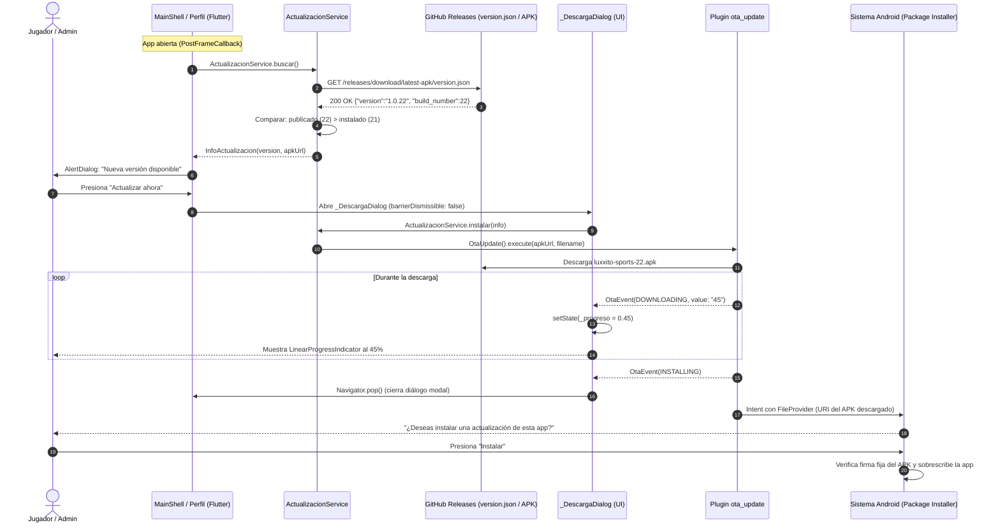

# Actualización In-App en Luxxito Sports Mobile

Este documento explica en detalle la arquitectura, componentes, configuración nativa y flujo de interfaz de usuario mediante los cuales **Luxxito Sports Mobile** detecta, descarga con barra de progreso y ejecuta actualizaciones de versión directamente desde el teléfono Android, sin necesidad de recurrir a tiendas externas.

---

## 1. Resumen Ejecutivo y Experiencia de Usuario

Cuando el usuario abre la aplicación (o consulta manualmente su versión en la pestaña **Perfil**), la app realiza una comprobación no bloqueante con el repositorio oficial:

1. **Detección transparente:** Compara el `buildNumber` compilado en el teléfono contra el archivo ligero `version.json` publicado en el canal correspondiente de GitHub Releases (`latest-apk` para producción).
2. **Aviso contextual:** Si existe una versión superior, despliega un diálogo emergente: *"Nueva versión disponible: Luxxito Sports 1.0.X ya está lista"*.
3. **Descarga dentro de la app con barra interactiva:** Si el usuario acepta (*"Actualizar ahora"*), se abre una ventana modal con un `LinearProgressIndicator` que refleja en tiempo real el porcentaje de bytes descargados ($0\% \to 100\%$).
4. **Instalación sobre la versión previa:** Al culminar la descarga, el diálogo se cierra automáticamente y cede el control al instalador nativo de Android, preservando la sesión y los datos del usuario gracias a la **firma criptográfica fija de release**.

---

## 2. Diagrama de Secuencia de la Actualización



---

## 3. Componentes Técnicos en Flutter

El mecanismo está desacoplado en dos capas limpias: **Lógica de Servicio** y **Widgets de Presentación**.

### 3.1. Servicio de Actualización (`mobile/lib/services/actualizacion_service.dart`)

Encapsula la inspección de versión y la delegación al plugin del sistema operativo:

* **Canal por entorno:** Lee `String.fromEnvironment('APK_CANAL')`. En compilaciones de producción (`apk.yml`), este valor se fija en `latest-apk`; en desarrollo local permanece vacío, desactivando la búsqueda automática para no interferir con pruebas de depuración.
* **Consulta de versión:** Usa `package_info_plus` para consultar el `buildNumber` del binario instalado y realiza una petición HTTP rápida (timeout de 12 s) al manifiesto de release:
  ```dart
  final res = await http.get(Uri.parse('$_repo/releases/download/$canal/version.json'));
  final data = jsonDecode(utf8.decode(res.bodyBytes));
  final publicado = (data['build_number'] as num?)?.toInt() ?? 0;
  if (publicado <= instalado) return null;
  ```
* **Disparador de descarga:** Devuelve un stream de eventos de estado `Stream<OtaEvent>`:
  ```dart
  static Stream<OtaEvent> instalar(InfoActualizacion info) {
    return OtaUpdate().execute(
      info.apkUrl,
      destinationFilename: 'luxxito-sports-${info.buildNumber}.apk',
    );
  }
  ```

---

### 3.2. Diálogos y Barra de Progreso (`mobile/lib/widgets/actualizacion_dialog.dart`)

Es el responsable de que el usuario vea la barra de progreso mientras los bytes ingresan al almacenamiento interno:

#### A. Disparo único por sesión
Para evitar molestar al usuario en cada navegación entre pestañas, la función `revisarActualizacionAlIniciar(context)` mantiene una bandera estática `_revisadoEnEstaSesion = true` y se invoca mediante:
```dart
WidgetsBinding.instance.addPostFrameCallback(
  (_) => revisarActualizacionAlIniciar(context),
);
```

#### B. Construcción y Animación de la Barra de Carga
El diálogo interno `_DescargaDialog` es un `StatefulWidget` que se suscribe al stream de eventos `OtaEvent`:

```dart
_suscripcion = ActualizacionService.instalar(widget.info).listen(
  (evento) {
    if (!mounted) return;
    switch (evento.status) {
      case OtaStatus.DOWNLOADING:
        final porcentaje = double.tryParse(evento.value ?? '');
        setState(() {
          // Normaliza de 0-100 a un valor entre 0.0 y 1.0 para el indicador
          _progreso = porcentaje == null ? null : porcentaje / 100;
        });
      case OtaStatus.INSTALLING:
      case OtaStatus.INSTALLATION_DONE:
        // Android toma el control con su instalador; se cierra el diálogo
        Navigator.of(context).pop();
      case OtaStatus.PERMISSION_NOT_GRANTED_ERROR:
        setState(() => _error = 'Android necesita tu permiso para instalar apps desconocidas.');
      default:
        setState(() => _error = 'No pudimos descargar la actualización.');
    }
  },
  onError: (Object e) {
    if (mounted) setState(() => _error = mensajeError(e));
  },
);
```

En el método `build`, la barra se renderiza con el widget nativo de Flutter:
```dart
Column(
  mainAxisSize: MainAxisSize.min,
  children: [
    LinearProgressIndicator(value: _progreso, minHeight: 6),
    const SizedBox(height: 12),
    Text(
      porcentaje == null
          ? 'Preparando la descarga…'
          : '$porcentaje% de Luxxito Sports ${widget.info.version}',
      style: const TextStyle(color: LuxxitoColors.textoSecundario),
    ),
  ],
)
```
* Si `_progreso` es `null`, `LinearProgressIndicator` muestra una animación indeterminada (mientras se establece el socket HTTPS).
* Tan pronto como `ota_update` envía el primer fragmento (ej. `"5"`), `_progreso` pasa a `0.05` y la barra se llena de forma continua y reactiva.

---

## 4. Configuración Nativa de Android Requerida

Para que una aplicación Android pueda descargar un binario ejecutable y pasarlo al instalador del sistema operativo sin ser bloqueada por las protecciones de seguridad de Android 7+ (API 24+), se configuraron tres elementos indispensables:

### 4.1. FileProvider Seguro (`AndroidManifest.xml`)
Android prohíbe exponer rutas de archivo planas (`file://`) hacia otras aplicaciones. Se configuró un `FileProvider` con autoridad propia:

```xml
<!-- mobile/android/app/src/main/AndroidManifest.xml -->
<provider
    android:name="sk.fourq.otaupdate.OtaUpdateFileProvider"
    android:authorities="${applicationId}.ota_update_provider"
    android:exported="false"
    android:grantUriPermissions="true">
    <meta-data
        android:name="android.support.FILE_PROVIDER_PATHS"
        android:resource="@xml/filepaths" />
</provider>
```

Y la ruta interna de almacenamiento en `mobile/android/app/src/main/res/xml/filepaths.xml`:
```xml
<paths xmlns:android="http://schemas.android.com/apk/res/android">
    <files-path name="internal_apk_storage" path="ota_update/"/>
</paths>
```
Esto permite que el instalador de Android reciba un `content://` URI temporal y seguro con permisos de lectura limitados exclusivamente a ese archivo APK.

### 4.2. Desugaring de Java 8+ (`build.gradle.kts`)
El plugin `ota_update` utiliza APIs modernas de Java (Streams y Time). En `mobile/android/app/build.gradle.kts` se activó el desugaring a nivel de compilación:

```kotlin
compileOptions {
    sourceCompatibility = JavaVersion.VERSION_17
    targetCompatibility = JavaVersion.VERSION_17
    isCoreLibraryDesugaringEnabled = true
}

dependencies {
    coreLibraryDesugaring("com.android.tools:desugar_jdk_libs:2.1.4")
}
```

---

## 5. La Clave de Firma Criptográfica Fija (Keystore en CI/CD)

### ¿Por qué fallaba antes la actualización sobre la app instalada?
Por seguridad, Android solo permite actualizar una aplicación existente (`INSTALL_REPLACE_EXISTING`) si el nuevo APK está **firmado exactamente con la misma clave RSA/ECDSA** que el que ya está instalado. Si la firma difiere, Android aborta la instalación con el error:
> *"No se puede instalar la aplicación: el paquete existente tiene una firma diferente."*

En un pipeline normal de GitHub Actions sin clave fija, cada ejecución creaba una clave temporal aleatoria, lo que obligaba al usuario a desinstalar la app para poder instalar la versión nueva.

### Solución Implementada:
En `.github/workflows/apk.yml`, el secret seguro `ANDROID_KEYSTORE_BASE64` se decodifica en un almacén `.jks` persistente y se inyecta en el build de Gradle:

```yaml
- name: Preparar clave de firma del APK
  env:
    ANDROID_KEYSTORE_BASE64: ${{ secrets.ANDROID_KEYSTORE_BASE64 }}
  run: |
    printf '%s' "$ANDROID_KEYSTORE_BASE64" | tr -d '[:space:]' | base64 --decode > "$RUNNER_TEMP/luxxito-release.jks"
    echo "ANDROID_KEYSTORE_PATH=$RUNNER_TEMP/luxxito-release.jks" >> "$GITHUB_ENV"
```

Y en `mobile/android/app/build.gradle.kts`:
```kotlin
signingConfigs {
    if (firmaReleaseDisponible) {
        create("release") {
            storeFile = file(keystorePath!!)
            storePassword = System.getenv("ANDROID_KEYSTORE_PASSWORD")
            keyAlias = System.getenv("ANDROID_KEY_ALIAS")
            keyPassword = System.getenv("ANDROID_KEYSTORE_PASSWORD")
        }
    }
}
```
Gracias a esto, **cada APK publicado en GitHub Actions comparte la misma firma oficial**. El usuario final puede instalar versiones sucesivas (v1.0.22 $\to$ v1.0.23 $\to$ ...) conservando su token JWT de autenticación y sus datos intactos.

---

## 6. Generación del Manifiesto `version.json` en CI/CD

Para que el teléfono sepa si hay una versión nueva sin tener que descargar el APK completo de 30+ MB, GitHub Actions genera un archivo JSON de apenas unos bytes (`build/app/outputs/flutter-apk/version.json`):

```bash
printf '{"version":"1.0.%s","build_number":%s,"commit":"%s","canal":"%s"}\n' \
  "${{ github.run_number }}" "${{ github.run_number }}" "${{ github.sha }}" \
  "${{ steps.env_info.outputs.TAG_NAME }}" > build/app/outputs/flutter-apk/version.json
```

Este archivo se adjunta como asset en el release de GitHub:
* URL pública de consulta: `https://github.com/Arbolito-ctrl/LuxxitoSports/releases/download/latest-apk/version.json`
* Ejemplo de contenido:
  ```json
  {
    "version": "1.0.22",
    "build_number": 22,
    "commit": "ac5a75cb1c2d0f5...",
    "canal": "latest-apk"
  }
  ```

---

## 7. Manejo de Errores y Casos Borde

| Escenario | Comportamiento del Sistema |
|---|---|
| **Sin conexión a Internet** | La consulta captura la excepción silenciosamente al inicio para no interrumpir el uso offline. Si se consulta desde Perfil, muestra un snackbar informativo. |
| **Permiso "Instalar apps desconocidas" denegado** | Android 8+ bloquea instalaciones de orígenes desconocidos por omisión. El diálogo captura `OtaStatus.PERMISSION_NOT_GRANTED_ERROR` e indica con precisión la ruta en los ajustes del teléfono para habilitarlo. |
| **Descarga interrumpida** | El diálogo permite pulsar **Reintentar**, reiniciando la suscripción al stream sin salir de la pantalla. |
| **Instalación cancelada por el usuario** | Si el usuario presiona "Cancelar" en el instalador del sistema operativo, la app actual sigue funcionando normalmente sin alterar su estado. |
