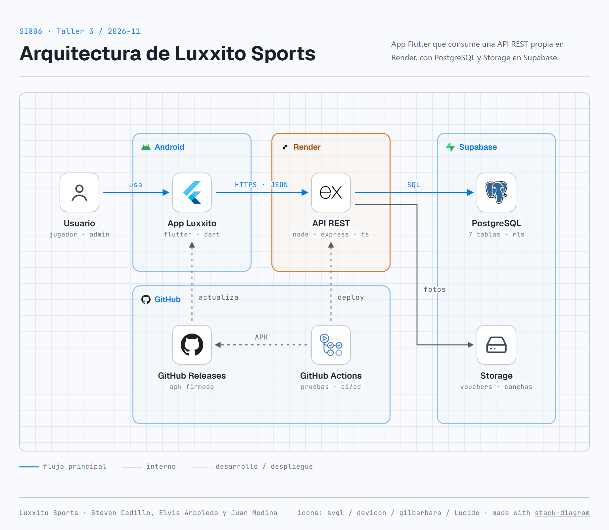

# Guía de estudio — Luxxito Sports (Taller 3 · SI806)

Guía para entender el proyecto de punta a punta y preparar la sustentación: qué hace el sistema, cómo viaja una petición desde la app hasta la base de datos, cómo funciona cada API, cómo se resuelve la concurrencia, un glosario de términos y las preguntas que podría hacer el profesor con su respuesta.

---

## 1. El proyecto en una página

**Problema.** El alquiler de canchas se gestiona por WhatsApp y cuadernos: se venden dos veces el mismo turno, se cobra mal la tarifa nocturna, se presta más equipamiento del que existe y no queda registro de pagos ni devoluciones.

**Solución.** Una app móvil Flutter (para el jugador y para el administrador del complejo) que consume una **API REST propia** en Node.js. La API es la única que decide: disponibilidad, precios, stock de extras, pagos, Ticket QR y reembolsos. Los datos viven en PostgreSQL (Supabase).



*Diagrama de arquitectura (versión interactiva: [`arquitectura/arquitectura.html`](arquitectura/arquitectura.html)).*

| Pieza | Tecnología | Dónde está |
|---|---|---|
| Cliente móvil | Flutter + Dart (Android) | `mobile/` |
| API REST | Node.js + Express + TypeScript | `backend/` |
| Base de datos | PostgreSQL en Supabase (7 tablas) | `backend/sql/schema.sql` |
| Archivos | Supabase Storage (buckets `comprobantes` y `canchas`) | — |
| Despliegue | Render (API), GitHub Actions (pruebas y APK) | `.github/workflows/` |
| Contrato | OpenAPI 3.0.3 | `contracts/openapi.yaml` |

**Flujo principal (lo que se mostró en la demo):** el jugador busca una cancha → ve horarios y precio (calculado por el servidor) → reserva y el turno queda bloqueado 20 minutos → paga por Yape y sube la foto del voucher → el ADMIN revisa y aprueba → el jugador recibe un Ticket QR → el ADMIN lo escanea en la puerta (sirve una sola vez) → si el jugador cancela, se aplica la política de 24 horas.

---

## 2. Cómo viaja una petición

Ejemplo: el jugador toca **Reservar**.

1. **App (Flutter).** `ApiService` arma un `POST https://luxxito-sports-api.onrender.com/api/reservas` con un cuerpo JSON y el encabezado `Authorization: Bearer <token>`.
2. **Render.** Recibe la petición HTTPS y la entrega al proceso Node (`node dist/server.js`).
3. **Express (`app.ts`).** Aplica CORS, lee el JSON (máximo 100 KB, 8 MB solo para fotos) y busca la ruta.
4. **Ruta (`routes/apiRoutes.ts`).** Decide qué middlewares y qué controlador atienden la ruta.
5. **Middlewares (`middlewares/authMiddleware.ts`).** `requireAuth` valida el JWT; `requireRole('ADMIN')` o `requireTitularDeReserva` revisan permisos. Si fallan, responden 401 o 403 y la petición no sigue.
6. **Controlador (`controllers/reservationController.ts`).** Lee `req.body`, llama al servicio y responde con `{ ok, data }` o pasa el error al manejador.
7. **Servicio (`services/reservationService.ts`).** Aplica las reglas: horario válido, sin solapamiento, stock de extras, precio día/noche y bloqueo de 20 minutos.
8. **Repositorio (`repositories/dataRepository.ts`).** Ejecuta el SQL dentro de una transacción contra PostgreSQL.
9. **Respuesta.** `201 Created` con la reserva, o un error con formato único: `{ "ok": false, "code": "CONFLICT", "message": "..." }`.

> Idea clave para la sustentación: **la app solo muestra y pide; el servidor decide.** Si alguien modifica la app o llama a la API desde Postman, las reglas se siguen cumpliendo porque viven en el servidor.

---

## 3. Arquitectura en capas

| Capa | Responsabilidad | No debe |
|---|---|---|
| Rutas | Asociar método + URL a un controlador y sus middlewares | Contener lógica de negocio |
| Middlewares | Autenticación y autorización | Consultar reglas de reservas |
| Controladores | Traducir HTTP ↔ servicio (leer petición, armar respuesta) | Escribir SQL |
| Servicios | Reglas de negocio y validaciones | Conocer detalles de HTTP |
| Repositorios | Acceso a datos (SQL, transacciones, Storage) | Decidir precios o permisos |

**¿Por qué así?** Cada capa cambia por una sola razón. Si mañana se cambia PostgreSQL por otra base, solo cambia el repositorio. Las pruebas pueden correr con un almacenamiento local (`LOCAL_STORE`) sin tocar los servicios.

---

## 4. Conceptos de API REST

| Concepto | Significado | En el proyecto |
|---|---|---|
| **API** | Interfaz que un programa expone para que otro lo use | La app usa la API para todo |
| **REST** | Estilo de diseño: recursos con URL propia, operaciones con métodos HTTP, sin estado entre peticiones | `/canchas`, `/reservas`, `/pagos` |
| **Recurso** | Una "cosa" del dominio identificada por una URL | `/api/reservas/19` es la reserva 19 |
| **Endpoint** | Combinación método + ruta | `POST /api/reservas` |
| **Sin estado (stateless)** | El servidor no recuerda peticiones anteriores; cada una trae todo lo necesario | El JWT viaja en cada petición |
| **JSON** | Formato de texto para intercambiar datos | Cuerpos y respuestas |
| **CRUD** | Create, Read, Update, Delete | `POST`, `GET`, `PUT`, `DELETE` sobre `/canchas` y `/reservas` |
| **Idempotencia** | Repetir la misma operación deja el mismo resultado | Aprobar dos veces un pago no suma dos veces |
| **Contrato (OpenAPI)** | Documento formal de rutas, parámetros y respuestas | `contracts/openapi.yaml` |
| **CORS** | Regla del navegador que limita qué sitios llaman a una API | Configurado en `app.ts` |

### 4.1. Métodos HTTP

| Método | Uso | ¿Idempotente? | Ejemplo |
|---|---|---|---|
| `GET` | Leer | Sí | `GET /api/canchas?deporte=Futbol 7` |
| `POST` | Crear o ejecutar una acción | No | `POST /api/reservas`, `POST /api/reservas/4/cancelar` |
| `PUT` | Reemplazar o actualizar un recurso | Sí | `PUT /api/canchas/3` |
| `PATCH` | Cambio parcial | Depende | `PATCH /api/pagos/5/aprobar` (lo hicimos idempotente) |
| `DELETE` | Eliminar | Sí | `DELETE /api/reservas/7` |

### 4.2. Códigos de estado que usamos

| Código | Significado | Cuándo lo devolvemos |
|---|---|---|
| `200 OK` | Todo bien | Consultas, aprobar, cancelar |
| `201 Created` | Se creó algo | Reserva, pago, cuenta, comprobante |
| `400 Bad Request` | Datos mal formados | DNI sin 8 dígitos, imagen no permitida |
| `401 Unauthorized` | No sabemos quién eres | Sin token, token alterado o vencido |
| `403 Forbidden` | Sabemos quién eres, pero no puedes | JUGADOR quiere aprobar pagos o ver la reserva de otro |
| `404 Not Found` | No existe | Reserva o cancha inexistente |
| `409 Conflict` | Choca con el estado actual | Turno ocupado, QR ya usado, nombre de cancha repetido |
| `413 Payload Too Large` | Cuerpo muy grande | Foto de más de 5 MB |
| `422 Unprocessable Entity` | Bien formado pero viola una regla | Hora pasada, fuera de horario, más de 4 horas |
| `500` / `502` / `503` | Error del servidor o de un servicio externo | Falla de base de datos o de Storage |

**Diferencia que suelen preguntar:** 400 es "no entiendo lo que me mandas"; 422 es "te entiendo, pero no se puede". 401 es "identifícate"; 403 es "ya te identificaste y no tienes permiso".

### 4.3. Los endpoints por grupo

- **Autenticación:** `POST /auth/registro`, `POST /auth/login`, `GET /auth/me`.
- **Catálogo:** `GET /complejos`, `GET /canchas`, `POST`/`PUT /canchas` (solo ADMIN), `POST /canchas/:id/imagen` (solo ADMIN).
- **Reservas:** `GET /canchas/:id/disponibilidad`, `POST /reservas/cotizar`, `POST /reservas`, `GET`/`PUT`/`DELETE /reservas/:id` (titular o ADMIN), `POST /reservas/:id/cancelar`.
- **Pagos:** `POST /pagos/comprobante` (foto), `POST /reservas/:id/pagos`, `GET /pagos` y `PATCH /pagos/:id/aprobar|rechazar` (solo ADMIN).
- **Ingreso:** `POST /reservas/verificar-qr` (solo ADMIN).
- **Operación:** `GET /health` (estado y versión), `GET /version` (última versión del APK).

---

## 5. Las reglas de negocio explicadas

### 5.1. Cotización día/noche
El servidor recorre cada hora del turno: antes de las 18:00 cobra la tarifa diurna y desde las 18:00 la nocturna. Suma los extras y calcula la seña del 50%. Ejemplo: 17:00–19:00 con 2 chalecos = S/ 90 + S/ 120 + S/ 30 = **S/ 240**.

### 5.2. Bloqueo de 20 minutos y vencimiento
Al reservar, la reserva queda `PENDIENTE_PAGO` con `expires_at = ahora + 20 min`. Si no llega el comprobante a tiempo, pasa a `VENCIDA` y el turno se libera. El vencimiento se aplica **de forma perezosa**: antes de consultar disponibilidad o crear reservas, el servidor marca como vencidas las que ya pasaron su hora (`expireOverdueReservas`). Con el comprobante enviado (`EN_REVISION`) ya no vence.

### 5.3. Exclusión mutua de turnos
Dos intervalos `[a, b)` y `[c, d)` se cruzan si `a < d` y `c < b`. Si una reserva activa de la misma cancha y fecha se cruza con la nueva, se responde 409.

### 5.4. Stock de extras por intervalo
Los chalecos o árbitros son del complejo y se comparten entre sus canchas. El servidor suma lo reservado en todas las reservas activas que se cruzan con el horario pedido y compara con `stock_total`.

### 5.5. Pago, aprobación y Ticket QR
El monto debe ser exactamente el 50% (`SENA_50`) o el 100% (`TOTAL`). Al aprobar, la reserva pasa a `CONFIRMADA` y se genera `LUXXITO-QR-<id>-<hash>`. Aprobar otra vez devuelve el mismo resultado (**idempotente**). En la puerta, el primer escaneo registra `qr_usado_at`; el segundo responde 409.

### 5.6. Cancelación de 24 horas
Con la hora de Lima: si faltan 24 horas o más, se devuelve el 100% de lo pagado; si faltan menos, se retiene el 50%. El QR se revoca (`codigo_qr = NULL`).

### 5.7. Estados de una reserva

| Estado | Significa | Pasa a |
|---|---|---|
| `PENDIENTE_PAGO` | Turno apartado 20 min | `EN_REVISION`, `VENCIDA`, `CANCELADA` |
| `EN_REVISION` | Comprobante enviado, esperando al ADMIN | `CONFIRMADA` (aprobado) o `PENDIENTE_PAGO` (rechazado, con 20 min nuevos) |
| `CONFIRMADA` | Pagado; tiene Ticket QR | `CANCELADA` |
| `VENCIDA` | No pagó a tiempo; turno liberado | — |
| `CANCELADA` | Cancelada con reembolso según la política | — |

---

## 6. Seguridad

| Concepto | Significado | En el proyecto |
|---|---|---|
| **Autenticación** | Comprobar quién eres | Login con correo y contraseña → JWT |
| **Autorización** | Comprobar qué puedes hacer | Roles JUGADOR/ADMIN y titularidad de reservas |
| **JWT (JSON Web Token)** | Token firmado con tres partes: cabecera, datos (payload) y firma | Lleva `id`, `dni`, `rol` y `exp`; se firma con HMAC-SHA256 y `JWT_SECRET` |
| **Firma HMAC** | Código calculado con una clave secreta; si alguien cambia el payload, la firma no coincide | Por eso un JUGADOR no puede cambiar su rol a ADMIN en el token |
| **`exp`** | Fecha de vencimiento del token | 30 días; después responde 401 |
| **Middleware** | Función que se ejecuta antes del controlador y puede cortar la petición | `requireAuth`, `requireRole`, `requireTitularDeReserva` |
| **Titularidad** | Solo el dueño de un recurso puede usarlo | El DNI del token debe ser el de la reserva (o ser ADMIN) |
| **Hash de contraseña** | Transformación de un solo sentido: no se puede volver a la contraseña | `scrypt` con sal aleatoria: `scrypt$<sal>$<hash>` |
| **Sal (salt)** | Valor aleatorio por usuario que se mezcla con la contraseña | Dos usuarios con la misma contraseña tienen hashes distintos |
| **scrypt** | Función de hash lenta a propósito y que usa memoria, para que adivinar contraseñas por fuerza bruta sea caro | Viene incluida en Node (`crypto.scryptSync`) |
| **Comparación en tiempo constante** | Comparar sin terminar antes al primer carácter distinto, para no filtrar pistas por el tiempo de respuesta | `crypto.timingSafeEqual` |
| **Bucket privado + URL firmada** | Archivo no público; se comparte con un enlace temporal | Vouchers en `comprobantes`, enlace de 1 hora para el ADMIN |
| **RLS (Row Level Security)** | Políticas de PostgreSQL que limitan qué filas puede leer cada rol de la base | Activado en las 7 tablas; solo el backend (service role) accede |
| **Variables de entorno / secretos** | Configuración sensible fuera del código | `backend/.env` (ignorado por Git), Render y GitHub Secrets |

> **Cifrar no es lo mismo que hashear.** Lo cifrado se puede descifrar con la clave; un hash no se "deshace". Por eso guardamos hashes de contraseñas: ni nosotros podemos leerlas. Al hacer login se calcula el hash de lo que escribió el usuario y se compara.

---

## 7. Concurrencia (lo más preguntado)

### 7.1. El problema
**Concurrencia** es cuando varias operaciones ocurren al mismo tiempo. El riesgo es una **condición de carrera (race condition)**: el resultado depende de quién llega primero y puede quedar inconsistente.

Ejemplo sin protección, con dos jugadores (A y B) que piden la cancha 1 a las 20:00 en el mismo milisegundo:

| Tiempo | Petición A | Petición B |
|---|---|---|
| t1 | Consulta: ¿hay reserva a las 20:00? → No | |
| t2 | | Consulta: ¿hay reserva a las 20:00? → No |
| t3 | Inserta la reserva de A | |
| t4 | | Inserta la reserva de B → **turno vendido dos veces** |

El patrón "consultar y luego escribir" (*check-then-act*) falla porque entre la consulta y la escritura otra petición se intercala.

### 7.2. Nuestras defensas (en capas)

1. **Restricción de exclusión en PostgreSQL (`reservas_sin_solapamiento`).** Es la defensa definitiva, porque la impone la propia base. Declara: "no pueden existir dos filas con la misma `cancha_id`, la misma `fecha` y rangos de horas que se crucen (`&&`), si están activas". Usa un índice GiST (con la extensión `btree_gist`). Si B intenta insertar, PostgreSQL lo rechaza con el error `23P01` y la API responde **409**: "El turno elegido acaba de ser reservado por otra persona".
2. **Cola en el servidor (`conBloqueo`).** Las reservas de una misma fecha se procesan una detrás de otra, y también las operaciones sobre una misma reserva (aprobar, rechazar, cancelar, verificar QR). Así se revisan juntos turnos y stock de extras sin que otra petición se intercale.
3. **Transacciones.** Crear la reserva y sus extras ocurre dentro de `BEGIN … COMMIT`; si algo falla, `ROLLBACK` deshace todo y no quedan reservas a medias.
4. **Actualización atómica del QR.** El ingreso se marca con un solo `UPDATE … WHERE qr_usado_at IS NULL`. Si dos escaneos llegan juntos, solo uno modifica la fila; el otro ve "0 filas afectadas" y responde 409.
5. **Idempotencia.** Aprobar o rechazar dos veces el mismo pago no duplica nada.

### 7.3. ¿Por qué no usamos *advisory locks*?
Un **advisory lock** es un candado que PostgreSQL ofrece a la aplicación. Lo probamos, pero Supabase se usa a través de un **pooler en modo transacción** (puerto 6543): varias peticiones comparten pocas conexiones y cada transacción puede ir por una conexión interna distinta. Un candado de sesión podía tomarse en una conexión y liberarse en otra, y quedaba trabado. Por eso usamos la cola en memoria más la restricción de la base, que funciona sin importar la conexión.

> **Limitación honesta:** la cola en memoria solo ordena peticiones dentro de **una** instancia del servidor. Con varias instancias seguiría siendo correcto, porque la restricción de exclusión de PostgreSQL es la garantía final, pero algunas peticiones recibirían 409 en vez de esperar su turno.

### 7.4. Cómo lo probamos
El caso 25 de las pruebas lanza varias peticiones simultáneas (`Promise.all`) por el mismo turno, los mismos extras, el mismo comprobante y la misma aprobación, y verifica que solo una gana y las demás reciben 409 (o el resultado idempotente).

---

## 8. Base de datos

| Concepto | Significado | En el proyecto |
|---|---|---|
| **Clave primaria (PK)** | Identificador único de cada fila | `id` en todas las tablas |
| **Clave foránea (FK)** | Columna que apunta a otra tabla y garantiza que exista | `reservas.cancha_id → canchas.id` |
| **1:N** | Un registro se relaciona con muchos | Un complejo tiene muchas canchas |
| **N:M** | Muchos con muchos, mediante una tabla intermedia | Reservas ↔ extras mediante `reserva_extras` |
| **CHECK** | Regla que cada fila debe cumplir | `precio_hora_nocturno >= precio_hora_diurno` |
| **UNIQUE / índice único** | No se repite el valor | Nombre de cancha único por complejo (sin distinguir mayúsculas) |
| **ON DELETE CASCADE** | Si se borra el padre, se borran sus hijos | Borrar una reserva borra sus extras y pagos |
| **Transacción** | Grupo de operaciones que se aplica completo o no se aplica | Reserva + extras |
| **ACID** | Atomicidad, Consistencia, Aislamiento y Durabilidad: garantías de una transacción | PostgreSQL las ofrece |
| **Pool de conexiones** | Conjunto de conexiones reutilizadas para no abrir una por petición | `pg.Pool` contra el pooler de Supabase |

Las 7 tablas: `usuarios`, `complejos`, `canchas`, `extras`, `reservas`, `reserva_extras` y `pagos`.

---

## 9. Pruebas y despliegue

| Concepto | Significado | En el proyecto |
|---|---|---|
| **Prueba automatizada** | Código que verifica el comportamiento sin intervención humana | 28 casos en `backend/src/tests/api.test.ts` |
| **Vitest** | Ejecutor de pruebas para TypeScript | `npm test` |
| **Supertest** | Librería que hace peticiones HTTP a la app Express sin levantar un servidor real | Cada caso llama a un endpoint |
| **Postman / Newman** | Herramienta para probar APIs a mano / la misma colección ejecutada por consola | 38 solicitudes y 63 aserciones |
| **Aserción** | Comprobación dentro de una prueba ("el código debe ser 409") | — |
| **CI/CD** | Integración y despliegue continuos: en cada cambio se prueba y se publica automáticamente | GitHub Actions: pruebas, despliegue a Render y APK |
| **Render** | Servicio que aloja la API | Plan gratuito: "se duerme" sin uso y tarda en despertar |
| **APK firmado** | Instalador de Android firmado con una clave fija | Permite actualizar la app sin desinstalar |
| **Health check** | Endpoint que dice si el servicio está bien | `GET /api/health` |

**Flujo de ramas:** cada integrante trabaja en `nombre/tema` → Pull Request a `develop` → cuando está estable, PR de `develop` a `main` → `main` se despliega solo en Render.

---

## 10. Glosario rápido

| Término | Significado corto |
|---|---|
| Backend | Parte del sistema que corre en el servidor (la API) |
| Frontend / cliente | Parte que usa la persona (la app Flutter) |
| Endpoint | Método + ruta de la API |
| Payload / cuerpo | Datos que viajan en la petición o la respuesta |
| Query param | Parámetro en la URL después de `?` (`?fecha=2026-11-05`) |
| Path param | Parámetro dentro de la ruta (`/reservas/:id`) |
| Header | Metadato de la petición (`Authorization`, `Content-Type`) |
| Bearer token | Token que se envía como `Authorization: Bearer <token>` |
| Base64 | Forma de representar bytes (una foto) como texto para enviarlos en JSON |
| MIME type | Tipo de archivo (`image/jpeg`) |
| Bucket | "Carpeta" de archivos en Supabase Storage |
| Supabase | Plataforma que da PostgreSQL, Storage y autenticación administrados |
| Pooler (PgBouncer/Supavisor) | Intermediario que reparte pocas conexiones reales entre muchas peticiones |
| Race condition | Error que aparece cuando dos operaciones simultáneas se intercalan |
| Exclusion constraint | Restricción que impide filas "en conflicto" (por ejemplo, rangos que se cruzan) |
| GiST | Tipo de índice de PostgreSQL que permite comparar rangos |
| Operación atómica | Se ejecuta completa o no se ejecuta; nadie ve un estado intermedio |
| Idempotente | Repetirla no cambia el resultado |
| Serializar | Ejecutar en fila, una después de otra |
| Middleware | Paso intermedio que procesa la petición antes del controlador |
| Hash | Huella de un solo sentido de un dato |
| Sal | Valor aleatorio que se mezcla antes de hashear |
| JWT | Token firmado que prueba quién es el usuario |
| RLS | Seguridad por filas en PostgreSQL |
| OpenAPI / Swagger | Formato estándar para describir una API |
| CI/CD | Pruebas y despliegue automáticos |
| Lazy (perezoso) | Se calcula solo cuando se necesita (el vencimiento de reservas) |

---

## 11. Preguntas que podría hacer el profesor

### Diseño y arquitectura

- **¿Por qué la API calcula el precio y no la app?** Porque el cliente no es confiable: cualquiera puede modificar la app o llamar a la API con Postman. Si el precio viniera del cliente, alguien podría pagar menos. El servidor es la única fuente de verdad.
- **¿Por qué separaron en capas?** Para que cada parte cambie por una sola razón y se pueda probar por separado. Por ejemplo, las pruebas usan un repositorio local sin cambiar los servicios.
- **¿Por qué REST y no otra cosa?** Es el estándar más simple para apps móviles: HTTP y JSON, que cualquier cliente entiende, con recursos claros y códigos de estado conocidos.
- **¿Qué pasa si Render se cae?** La app muestra un error de conexión y no se pierde nada, porque los datos están en Supabase. El plan gratuito se "duerme" y tarda en despertar; por eso la app espera hasta 60 segundos.
- **¿Por qué `POST /reservas/:id/cancelar` y no `DELETE`?** Cancelar no borra la reserva: cambia su estado, calcula el reembolso y revoca el QR. `DELETE` sí la elimina físicamente, y solo si no está confirmada.

### Concurrencia

- **¿Qué pasa si dos personas reservan el mismo turno al mismo tiempo?** Solo una lo consigue. La restricción de exclusión de PostgreSQL impide dos reservas activas solapadas y la otra persona recibe 409. Además, una cola en el servidor procesa en orden las reservas de una misma fecha.
- **¿No bastaba con consultar si el turno estaba libre antes de insertar?** No: entre la consulta y la inserción otra petición puede colarse (*check-then-act*). La garantía tiene que estar en la base de datos.
- **¿Y si el ADMIN escanea el mismo QR dos veces muy rápido?** El ingreso se marca con un `UPDATE` atómico condicionado a que `qr_usado_at` sea nulo. Solo uno lo modifica; el otro recibe 409.
- **¿Qué significa que la aprobación sea idempotente?** Que si el ADMIN aprueba dos veces (doble toque o reintento por mala señal), el monto pagado no se suma dos veces y se devuelve el mismo resultado.
- **¿Por qué no usaron bloqueos de PostgreSQL?** Porque con el pooler en modo transacción de Supabase el candado podía quedar en otra conexión y no liberarse. La restricción de exclusión funciona en cualquier conexión.
- **¿Y si hay dos servidores?** La cola solo ordena dentro de uno, pero la restricción de la base sigue impidiendo el doble turno. Lo peor que pasaría es que algunas peticiones reciban 409 en lugar de esperar.

### Seguridad

- **¿Qué es un JWT y cómo saben que no fue alterado?** Es un token con datos (id, dni, rol, vencimiento) y una firma HMAC calculada con una clave que solo tiene el servidor. Si alguien cambia el rol, la firma ya no coincide y responde 401.
- **¿Diferencia entre 401 y 403?** 401: no hay token o no es válido (no sé quién eres). 403: el token es válido, pero tu rol o tu relación con el recurso no te permiten la acción.
- **¿Cómo guardan las contraseñas?** Con `scrypt` y una sal aleatoria por usuario. No se pueden recuperar; al hacer login se calcula el hash y se compara en tiempo constante.
- **¿Por qué una sal?** Para que dos contraseñas iguales tengan hashes distintos y no se puedan usar tablas precalculadas.
- **¿Puede un jugador ver las reservas de otro?** No. `GET /reservas/:id` y las acciones sobre una reserva exigen que el DNI del token sea el de la reserva (o ser ADMIN); si no, 403. En el listado, el jugador solo recibe las suyas.
- **¿Dónde están las claves de Supabase?** En variables de entorno de Render y en GitHub Secrets. El repositorio solo tiene `backend/.env.example` sin valores reales.
- **¿Por qué el bucket de comprobantes es privado?** Porque un voucher tiene datos personales. El ADMIN lo ve con un enlace firmado que vence en 1 hora.

### Base de datos

- **¿Qué relación hay entre reservas y extras?** Muchos a muchos, mediante `reserva_extras`, que además guarda la cantidad y el precio de ese momento.
- **¿Por qué guardan el precio en `reserva_extras` si ya está en `extras`?** Porque el precio puede cambiar mañana y la reserva debe conservar el precio con el que se cobró.
- **¿Qué es una transacción y dónde la usan?** Un grupo de operaciones que se aplica completo o se deshace. Al crear una reserva con extras: si falla la inserción de un extra, no queda la reserva a medias.
- **¿Cómo vence una reserva si nadie hace nada?** El vencimiento es perezoso: antes de consultar disponibilidad o crear reservas, el servidor marca como `VENCIDA` toda reserva `PENDIENTE_PAGO` cuyo `expires_at` ya pasó.

### Pruebas

- **¿Cómo prueban que funciona?** Con 28 pruebas automatizadas (éxitos, fallos, seguridad y concurrencia) que corren en cada cambio en GitHub Actions; con Postman/Newman (38 solicitudes, 63 aserciones); y con la demostración real en un celular contra Render y Supabase.
- **¿Las pruebas usan la base real?** No: usan un almacenamiento local para ser rápidas y repetibles. La base real se validó en la demostración, con capturas y el estado de Supabase como evidencia.
- **Muestren un caso de fallo.** Reservar un turno ya ocupado → 409; reservar a una hora que ya pasó → 422; aprobar un pago con token de jugador → 403.

---

## 12. Comandos útiles para la sustentación

```bash
# Pruebas del backend
cd backend && npm test

# Levantar la API localmente
cd backend && npm run dev

# Ejecutar la colección de Postman por consola
npx newman run docs/LuxxitoSports.postman_collection.json --env-var baseUrl=https://luxxito-sports-api.onrender.com/api

# Ver el estado de la API pública
curl https://luxxito-sports-api.onrender.com/api/health
```
