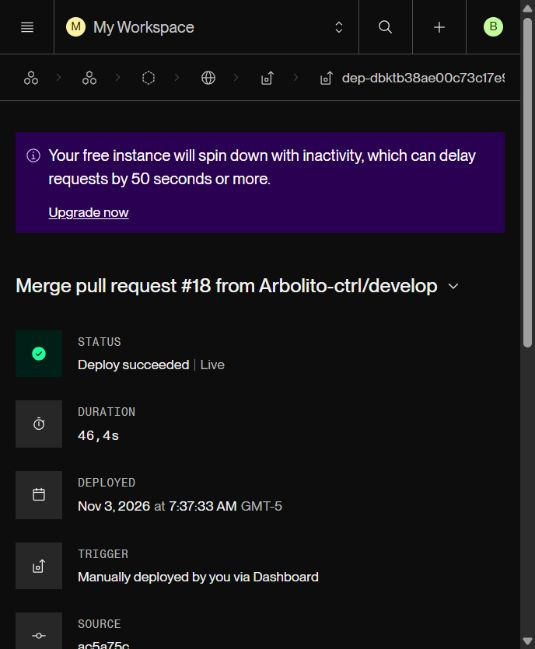

# Infraestructura de entrega — issue #14

Fecha: 3 de noviembre de 2026 (Perú). Responsable: **Juan Medina (`jc2709`)**.
Rama de implementación: `juan/despliegue-apk-validacion`. [PR #17](https://github.com/Arbolito-ctrl/LuxxitoSports/pull/17) integrado a develop con squash (`670df99`); [PR #18](https://github.com/Arbolito-ctrl/LuxxitoSports/pull/18) integrado a main con merge commit (`ac5a75c`). Evidencia posterior en `juan/evidencia-android-infra`.

## Alcance acordado

Workflow APK, servicio público, configuración de conexión, prueba física de acceso/catálogo/reserva y documentación. Los fallos de pagos, comprobantes y QR se atenderán después, según indicación de Juan. Esta evidencia no los declara corregidos ni cierra la aceptación completa de la issue.

## Resultados observados

| Comprobación | Evidencia / resultado |
|---|---|
| Conexión privada a PostgreSQL | `SELECT 1` correcto; no se muestra la cadena de conexión. |
| Render | Servicio Free actualizado al commit `ac5a75c` de main, activo el 03/11 a las 07:38 de Perú. Deploy `dep-dbktb38ae00c73c17e9g`. |
| URL pública | `https://luxxito-sports-api.onrender.com/api/health`: HTTP 200, `POSTGRES_POOL`, `db_ready=true`, comprobado a las 07:39 de Perú. |
| HTTP contra la nube | Catálogo: 3 complejos y 6 canchas; login demo jugador 200; `/auth/me` 200; pagos sin sesión 401 y con jugador 403. [Resultados sin tokens](capturas/infra-http-checks.json). |
| Configuración GitHub | `API_BASE_URL` actualizado mediante API cifrada; no se almacenó en archivos versionados. |
| Backend local | `npm run build` correcto; `npm test`: 21/21, con almacenamiento local. |
| Regresión de configuración | `node --test .github/scripts/validate-apk-config.test.cjs`: 3/3. Rechaza valor con paréntesis y direcciones de emulador/locales. |
| CI de main | [Ejecución 41637229633](https://github.com/Arbolito-ctrl/LuxxitoSports/actions/runs/41637229633): **verde**, commit `ac5a75c`. |
| APK de desarrollo | [Ejecución 41636523315](https://github.com/Arbolito-ctrl/LuxxitoSports/actions/runs/41636523315): **verde**, incluida compilación y publicación de `dev-apk` del commit `670df99`. |
| APK de producción | [Ejecución 41637229736](https://github.com/Arbolito-ctrl/LuxxitoSports/actions/runs/41637229736): **verde**, publicación de [latest-apk](https://github.com/Arbolito-ctrl/LuxxitoSports/releases/tag/latest-apk), tag y notas del commit `ac5a75ca541d98fec4bb3aed70966246dc4ed4d0`. |
| Android físico | TECNO SPARK 20, modelo TECNO KJ5, Android 13, pantalla 720×1612. Instalación ADB exitosa del archivo de producción; versión instalada `1.0.22`, build `22`. |

## Recorrido observado en el TECNO (07:44–07:46 de Perú)

1. Descargar `luxxito-sports.apk` de `latest-apk`, verificar tag/notas contra `ac5a75c` e instalar. Tamaño: 53 440 768 bytes. SHA-256: `17520da96a67ba70659dcf93ecc35bbde5944293272a8d10f8072f17349274a1`.
2. Iniciar sesión con la cuenta demo de jugador existente: acceso correcto. Explorar carga **6 canchas** sin `[0 TIMEOUT]`.
3. Abrir Cancha Monumental 1 y consultar disponibilidad del **04/11/2026, 07:00–08:00**.
4. Añadir **1 Juego de Chalecos (x12)**: cancha S/90 + extra S/15 = **S/105**, cotización visible.
5. Reservar: aparece “¡Turno reservado!” y la **reserva #1** queda “Por pagar”, sin pagos, con contador de 20 minutos.
6. Abrir Perfil: datos del jugador cargan correctamente. No se publica captura de DNI/teléfono.
7. Cerrar completamente la app, abrirla y volver a iniciar sesión: la reserva #1 se recupera en Mis reservas, por S/105 y con el mismo extra. La sesión requiere nuevo login tras cerrar el proceso; no se afirma persistencia del inicio de sesión.

No se registró ni aprobó un pago, ni se cargó un archivo, ni se verificó un QR en este recorrido. La reserva de prueba queda sin pago y sujeta al vencimiento normal; esta sesión no acredita el cambio real a VENCIDA tras 20 minutos.

| Captura | Qué demuestra |
|---|---|
| [Explorar](capturas/android-explorar.png) | Login correcto y catálogo de 6 canchas en el teléfono. |
| [Cotización con extra](capturas/android-cotizacion-extras.png) | Selección de horario y total S/105. |
| [Reserva creada](capturas/android-reserva-creada.png) | Respuesta visible de creación del turno. |
| [Mis reservas](capturas/android-mis-reservas.png) | Reserva #1, extra y contador del bloqueo. |
| [Tras reiniciar](capturas/android-reserva-persistida.png) | La reserva se recupera después de cerrar el proceso y autenticarse de nuevo. |

## Pendientes para cerrar #14

- [x] Confirmar workflow APK verde y asset del release correspondiente al commit compilado.
- [x] Promover a develop con squash y después a main con merge commit, con checks aplicables verdes en develop.
- [x] Desplegar la versión promovida y repetir health/consultas.
- [x] Instalar el APK nuevo en Android físico y registrar modelo, versión, fecha y pasos.
- [x] Ejecutar y registrar el recorrido permitido por las funciones actuales; los fallos aplazados constan y no se presentan como aprobados.
- [ ] Registrar una prueba física de registro de usuario nuevo y del vencimiento real tras 20 minutos.
- [ ] Atender pagos, upload real y QR; luego ejecutar el flujo completo y el segundo escaneo 409 antes de cerrar la issue.

No se ejecutó `db:init` ni se resembró la base compartida. Ninguna captura contiene secretos. Las pruebas con almacenamiento local no acreditan persistencia de QR ni upload real.
