# Guion y Evidencia de la Demostración — Taller 3 (LX-303)

**Responsable:** Steven (con apoyo de Elvis y Juan)
**Requisito (diapositiva 6 del Taller 3):** *"DEMOSTRACIÓN: Cliente consumiendo la API; operación completa y cambio persistido en base de datos."*
**Duración estimada:** 8–10 minutos

| Componente | Qué se muestra |
|---|---|
| Cliente | App móvil Flutter en un celular Android físico |
| API | Backend propio Node.js + Express + TypeScript (`/api`) |
| Base de datos | Supabase PostgreSQL (Table Editor o SQL Editor) |

---

## 0. Preparación (antes de presentar)

### 0.1 Checklist

**Opción recomendada: APK de producción** (sin laptop ni cable; la app usa la API pública en Render, conectada a Supabase).
- [ ] Celular con la última versión de `latest-apk`. Si la app avisa "Nueva versión disponible", actualizar antes de presentar.
- [ ] API en línea: `https://luxxito-sports-api.onrender.com/api/health` responde `"db_mode": "POSTGRES_POOL"`. El plan gratuito de Render "duerme": abrir este enlace 1 o 2 minutos antes para despertarla.
- [ ] Dos sesiones a mano: el **jugador** en la app y el **ADMIN** en otro celular. Con un solo celular, se cierra y abre sesión entre los pasos.
- [ ] Supabase abierto en el navegador: **Table Editor** con `reservas`, `reserva_extras` y `pagos`, una pestaña de **SQL Editor** con las consultas de la [sección 3](#3-consultas-sql-de-respaldo) y **Storage → comprobantes** para mostrar el voucher.
- [ ] Postman con la colección `docs/LuxxitoSports.postman_collection.json` (para el paso 4 y como respaldo). Usar `baseUrl = https://luxxito-sports-api.onrender.com/api`.
- [ ] Una foto o captura de un voucher de Yape o Plin guardada en el celular (para el paso 5.1).
- [ ] Brillo del celular al máximo y la pantalla duplicada en el proyector (por ejemplo con `scrcpy`).

**Alternativa sin internet: backend local por cable**
```bash
cd backend && npm run dev                      # con backend/.env de Supabase (lo entrega Elvis)
adb reverse tcp:3000 tcp:3000
cd mobile && flutter run --dart-define=API_BASE_URL=http://127.0.0.1:3000/api
```

### 0.2 Datos de la demo

| Dato | Valor |
|---|---|
| Cuenta jugador | `elvis.arboleda@uni.pe` / `luxxito2026` (DNI `74125896`) |
| Cuenta administrador | `admin@luxxitosports.pe` / `admin2026` |
| Cancha | **Cancha Monumental 1** · Futbol 7 · Luxxito Arena San Miguel |
| Fecha | Al menos **2 días después** de la presentación (así la cancelación es con más de 24 h) |
| Horario | **17:00 – 19:00** (1 hora diurna + 1 hora nocturna) |
| Extras | 2 × Juego de Chalecos (S/ 15 c/u) |
| Total esperado | S/ 90 (día) + S/ 120 (noche) + S/ 30 (chalecos) = **S/ 240.00** · seña 50% = S/ 120.00 |

---

## 1. Guion paso a paso

> En cada paso: **acción** en la app → **qué decir** → **qué verificar** → **captura**. Las capturas se guardan en `docs/validaciones/capturas/` con el nombre indicado.

### Paso 1 — El cliente consume la API: catálogo y filtros

| | |
|---|---|
| **Acción** | Iniciar sesión como jugador. En **Explorar**, tocar el filtro **San Miguel** y luego **Futbol 7**. |
| **Qué decir** | "La app no tiene datos locales: cada lista viene de `GET /api/complejos` y `GET /api/canchas?distrito=…&deporte=…`, que consultan PostgreSQL en Supabase." |
| **Verificar** | Solo aparecen canchas de Futbol 7 en San Miguel, con foto, insignias y precio. |
| **Captura** | `01-explorar-filtros.png` |

### Paso 2 — Disponibilidad y cotización calculada por el servidor

| | |
|---|---|
| **Acción** | Tocar **Reservar** en *Cancha Monumental 1*. Elegir la fecha de la demo, tocar **17:00** y luego **18:00** (2 horas seguidas). En **Extras**, sumar 2 juegos de chalecos. |
| **Qué decir** | "Los horarios vienen de `GET /api/canchas/1/disponibilidad`. El precio **no lo calcula la app**: cada cambio llama a `POST /api/reservas/cotizar`. Desde las 18:00 rige la tarifa nocturna, por eso la segunda hora cuesta más." |
| **Verificar** | Resumen: Cancha 2 h = **S/ 210.00**, Extras = **S/ 30.00**, Total = **S/ 240.00**, adelanto 50% = **S/ 120.00**. |
| **Captura** | `02-cotizacion-servidor.png` |

### Paso 3 — Crear la reserva y verla persistida en Supabase ⭐

| | |
|---|---|
| **Acción** | Tocar **Reservar** en la barra inferior. Aparece "¡Turno reservado!". Ir a **Mis reservas**. |
| **Qué decir** | "`POST /api/reservas` respondió **201 Created**. El servidor validó horario, solapamiento y stock de extras, y bloqueó el turno 20 minutos (`expires_at`)." |
| **Verificar en la app** | Tarjeta **Por pagar** con la cuenta regresiva "Turno guardado por 19:xx". |
| **Verificar en Supabase** | En `reservas`, la fila nueva con `estado = PENDIENTE_PAGO`, `total = 240`, `fecha`, `hora_inicio = 17`, `hora_fin = 19` y `expires_at`. En `reserva_extras`, la fila con `extra_id = 1`, `cantidad = 2`, `subtotal = 30`. |
| **Capturas** | `03a-reserva-creada-app.png`, `03b-supabase-reservas.png`, `03c-supabase-reserva-extras.png` |

### Paso 4 — Exclusión mutua: intento de reserva duplicada (409 Conflict)

Primero se muestra que el turno de la reserva del paso 3 ya no se ofrece. Después se simula a dos clientes compitiendo por un turno libre.

| | |
|---|---|
| **Acción 1 (bloqueo visible)** | Volver a **Explorar → Cancha Monumental 1 → fecha de la demo**. Los turnos **17:00** y **18:00** aparecen tachados como *Reservándose*. |
| **Acción 2 (dos clientes, mismo turno)** | En el celular, tocar **20:00** (sin confirmar). Desde **Postman**, enviar `POST {{baseUrl}}/reservas` con el cuerpo de abajo (mismo día, 20:00–21:00). Volver al celular y tocar **Reservar**. |
| **Acción alternativa (solo Postman)** | Enviar dos veces el mismo cuerpo: la primera responde `201` y la segunda `409`. |
| **Qué decir** | "Dos clientes intentan el mismo turno. El servidor es la autoridad: el segundo recibe **409 Conflict** y la app se lo explica al usuario sin romperse." |
| **Verificar** | En la app aparece "Ese horario ya no está libre" con el mensaje del servidor, y al tocar *Ver horarios actualizados* el turno de las 20:00 sale bloqueado. En Postman se ve `409` con `"code": "CONFLICT"`. En Supabase hay **una sola** fila activa para cada horario. |
| **Capturas** | `04a-turnos-bloqueados.png`, `04b-conflicto-409-app.png` (o `04b-conflicto-409-postman.png`) |

Cuerpo para Postman (reemplazar la fecha por la de la demo):

```json
{
  "cancha_id": 1,
  "cliente_nombre": "Cliente Competidor",
  "cliente_dni": "71234567",
  "cliente_telefono": "987654321",
  "cliente_email": "competidor@uni.pe",
  "fecha": "AAAA-MM-DD",
  "hora_inicio": 20,
  "hora_fin": 21
}
```

### Paso 5 — Pago con foto, revisión del ADMIN, ingreso con QR y cancelación ⭐

**5.1 El jugador envía el comprobante con foto**

| | |
|---|---|
| **Acción** | En **Mis reservas**, tocar **Pagar** → *Pago total* → *Yape* → N° de operación `YAPE-8492014` → en **"3. Adjunta la captura del pago"** elegir la foto del voucher (**Galería** o **Cámara**) → **Enviar comprobante**. |
| **Qué decir** | "La foto se sube a un bucket **privado** de Supabase Storage (`POST /api/pagos/comprobante`) y luego `POST /api/reservas/:id/pagos` registra el pago con esa foto. El turno queda protegido mientras se revisa." |
| **Verificar** | La reserva pasa a **En revisión**. En Supabase: `pagos.estado = PENDIENTE_REVISION` con `comprobante_url = supabase://comprobantes/reserva-…`, `reservas.estado = EN_REVISION`, y el archivo aparece en **Storage → comprobantes**. |
| **Capturas** | `05a-pago-con-foto.png`, `05b-storage-comprobante.png` |

**5.2 El ADMIN revisa el voucher y aprueba**

| | |
|---|---|
| **Acción** | Entrar como **administrador**. En la barra inferior: **Inicio** muestra "1 pago por revisar" → pestaña **Pagos** → ver la foto del voucher (tocarla para ampliar) → **Aprobar** → *Sí, aprobar*. |
| **Qué decir** | "El ADMIN tiene su propia app. Solo un token con rol `ADMIN` puede usar `GET /api/pagos` y `PATCH /api/pagos/:id/aprobar`; con rol de jugador responde `403`. Como el bucket es privado, la foto se ve con un enlace firmado que vence en 1 hora. Aprobar dos veces no duplica el pago." |
| **Verificar** | En Supabase: `pagos.estado = APROBADO` con `reviewed_at`; `reservas.estado = CONFIRMADA`, `monto_pagado = 240` y `codigo_qr = LUXXITO-QR-…`. El jugador ve **Confirmada** y el botón **Ticket** con el código QR. |
| **Capturas** | `05c-inicio-admin.png`, `05d-bandeja-pagos-foto.png`, `05e-ticket-qr.png`, `05f-supabase-confirmada.png` |

**5.3 Ingreso al complejo con el Ticket QR**

| | |
|---|---|
| **Acción** | El jugador muestra **Mis reservas → Ticket**. El ADMIN abre la pestaña **Ingreso** y escanea el QR con la cámara (o escribe el código `LUXXITO-QR-…`). Luego **escanea el mismo QR otra vez**. |
| **Qué decir** | "`POST /api/reservas/verificar-qr` registra el ingreso **una sola vez**: el segundo escaneo responde `409`. La marca se guarda con una única operación en PostgreSQL, así que ni dos escaneos simultáneos dejan entrar dos veces." |
| **Verificar** | 1.er escaneo: **"Ingreso registrado"** en verde, con el jugador, la cancha y el horario. 2.º escaneo: **"Ticket no válido para ingresar"** en rojo. En Supabase: `reservas.qr_usado_at` con la hora. En **Inicio**, el turno aparece como **Ingresó**. |
| **Capturas** | `05g-ingreso-registrado.png`, `05h-qr-ya-usado.png`, `05i-supabase-qr-usado.png` |

**5.4 Cancelación con política de 24 horas**

Usar **otra reserva confirmada** que todavía no haya ingresado (por ejemplo, la del paso extra o una creada con Postman), para mostrar el reembolso.

| | |
|---|---|
| **Acción** | En la reserva confirmada, menú **⋮ → Cancelar reserva**. El diálogo muestra "Te devolveremos S/ …". Confirmar con **Sí, cancelar**. |
| **Qué decir** | "`POST /api/reservas/:id/cancelar` aplica la política: con más de 24 h se devuelve el 100%; con menos, se retiene el 50%. El QR se revoca para que no pueda usarse." |
| **Verificar** | Reserva **Cancelada** con el reembolso. En Supabase: `estado = CANCELADA`, `monto_devolucion`, `codigo_qr = NULL` y `motivo_cancelacion`. Si se intenta verificar su QR, responde `409` (ticket revocado). |
| **Capturas** | `05j-cancelacion-app.png`, `05k-supabase-cancelada.png` |

### Paso extra (si sobra tiempo) — Rechazo de comprobante

Crear otra reserva, enviar un comprobante y, como administrador, **Rechazar** con el motivo *"Número de operación inválido"*. El jugador ve el aviso rojo con el motivo y la reserva vuelve a **Por pagar** con 20 minutos nuevos. En Supabase: `pagos.estado = RECHAZADO` con `observacion`. Captura: `06-rechazo-comprobante.png`.

---

## 2. Registro de evidencia

**Ejecución:** 3 de noviembre de 2026, de 15:38 a 15:54 (hora de Lima) · **APK de producción 1.0.36** en un motorola edge 50 (Android 16) · API pública `https://luxxito-sports-api.onrender.com/api` con `db_mode = POSTGRES_POOL` (Supabase).
**Datos:** reserva **#19** (Cancha Monumental 1, jue 5 nov, 17:00–19:00, 2 chalecos), pago **#5**, competidor **#20** y cancelación de la reserva **#4**.

| Paso | Endpoint | Código | Evidencia en la app | Estado persistido en Supabase | ✔ |
|---|---|---|---|---|---|
| 1 | `GET /api/canchas?distrito=…&deporte=…` | 200 | [01-explorar-filtros](capturas/01-explorar-filtros.png) | — | ✅ |
| 2 | `POST /api/reservas/cotizar` | 200 | [02-cotizacion-servidor](capturas/02-cotizacion-servidor.png) | S/ 210 cancha + S/ 30 extras = **S/ 240**; seña S/ 120 | ✅ |
| 3 | `POST /api/reservas` | 201 | [03a-reserva-creada-app](capturas/03a-reserva-creada-app.png) | `reservas` #19: `PENDIENTE_PAGO`, total 240, `expires_at` en 20 min · `reserva_extras`: chalecos ×2 = 30 | ✅ |
| 4 | Turno bloqueado + `POST /api/reservas` (mismo turno) | 409 | [04a-turnos-bloqueados](capturas/04a-turnos-bloqueados.png) · [04b-conflicto-409-app](capturas/04b-conflicto-409-app.png) | 17:00 y 18:00 "Reservándose"; el competidor tomó 20:00 (#20) y la app recibió 409 | ✅ |
| 5.1 | `POST /api/pagos/comprobante` + `POST /api/reservas/19/pagos` | 201 | [05a-pago-en-revision](capturas/05a-pago-en-revision.png) | `pagos` #5: `PENDIENTE_REVISION`, `YAPE-8492014`, `comprobante_url = supabase://comprobantes/reserva-19/…jpg` · Storage: `voucher-…jpg` (63 KB) · reserva `EN_REVISION` | ✅ |
| 5.2 | `GET /api/pagos` · `PATCH /api/pagos/5/aprobar` (ADMIN) | 200 | [05c-inicio-admin](capturas/05c-inicio-admin.png) · [05d-bandeja-pagos-foto](capturas/05d-bandeja-pagos-foto.png) · [05e-ticket-qr](capturas/05e-ticket-qr.png) | pago #5 `APROBADO` (`reviewed_at` 15:48) · reserva #19 `CONFIRMADA`, `monto_pagado` 240, `codigo_qr = LUXXITO-QR-19-EAFECA58D7` | ✅ |
| 5.3 | `POST /api/reservas/verificar-qr` (1.º y 2.º) | 200 / 409 | [05g-ingreso-registrado](capturas/05g-ingreso-registrado.png) · [05h-qr-ya-usado](capturas/05h-qr-ya-usado.png) | `qr_usado_at` = 15:50; el segundo escaneo respondió "ya fue utilizado" | ✅ |
| 5.4 | `POST /api/reservas/4/cancelar` (jugador) | 200 | [05j-cancelacion-app](capturas/05j-cancelacion-app.png) | reserva #4 `CANCELADA`, `monto_devolucion` 120 (100 %), `codigo_qr = NULL`; su QR responde 409 "revocado" | ✅ |

> En la captura `05d` el voucher está **difuminado**: la imagen de prueba era un Yape real con datos de otra persona. El archivo original sigue en el bucket **privado** `comprobantes` y solo el ADMIN lo ve, con un enlace firmado.

El estado de Supabase se consultó con las sentencias de la [sección 3](#3-consultas-sql-de-respaldo) y quedó guardado en [`capturas/evidencia-supabase-demo.json`](capturas/evidencia-supabase-demo.json).

### Galería

| Catálogo | Cotización | Reserva creada | Turnos bloqueados |
|---|---|---|---|
| 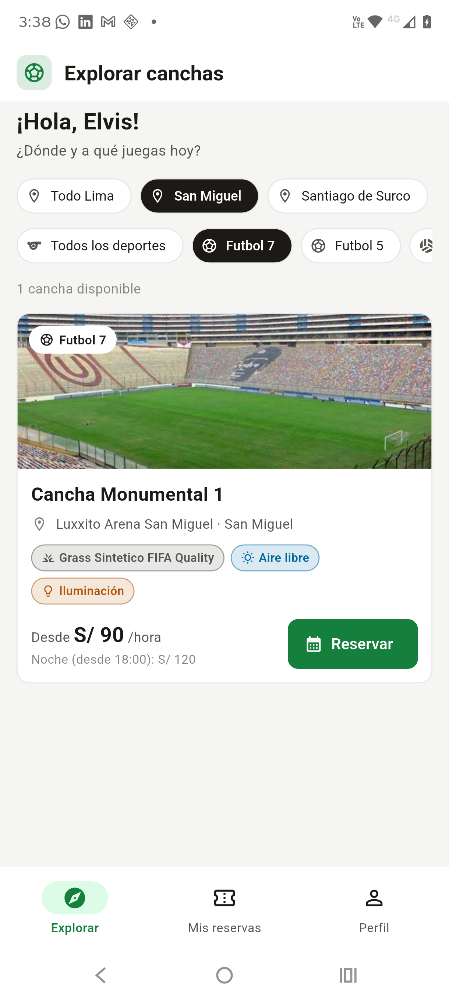 | 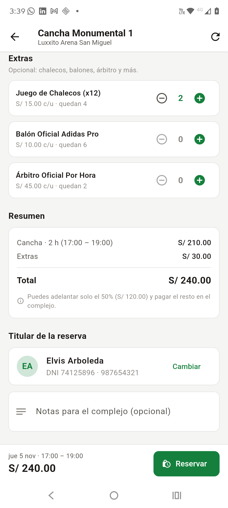 | 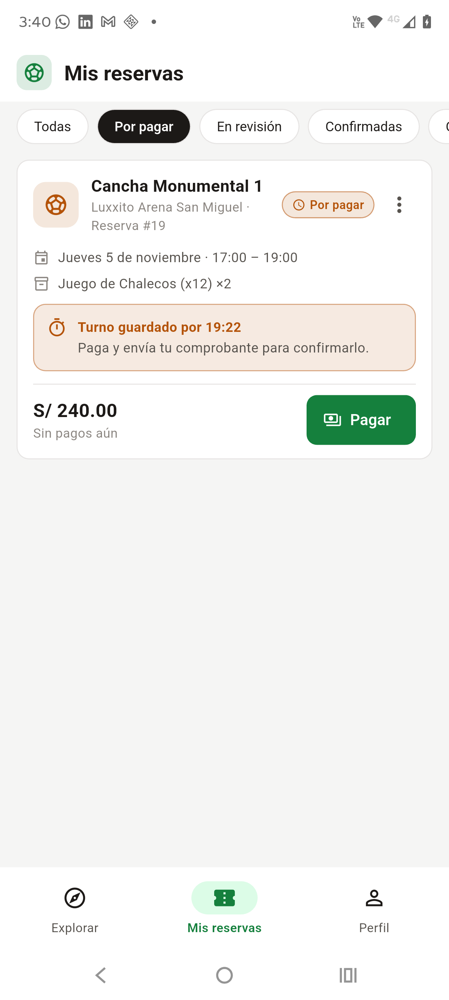 | 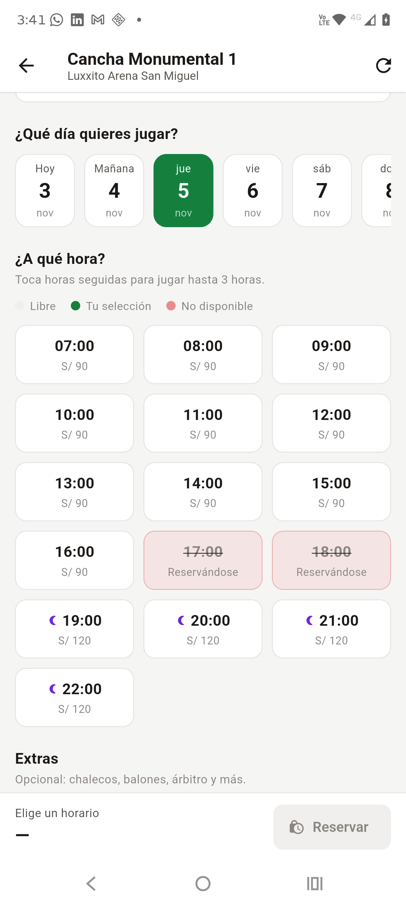 |
| **409 en la app** | **Pago en revisión** | **Panel del ADMIN** | **Bandeja con voucher** |
| 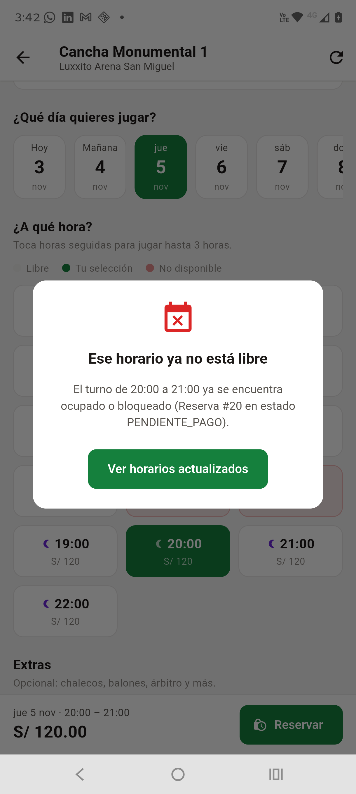 | 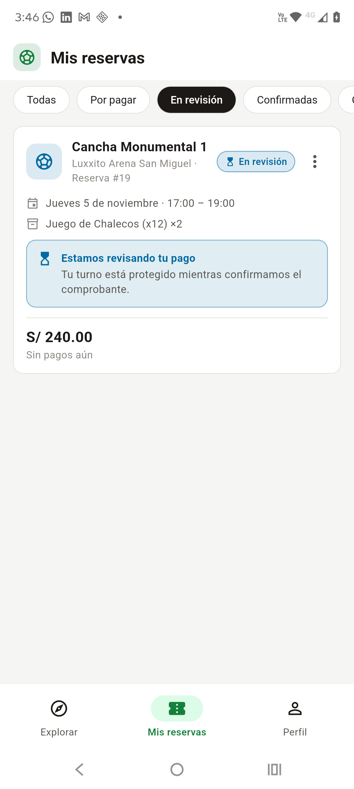 | 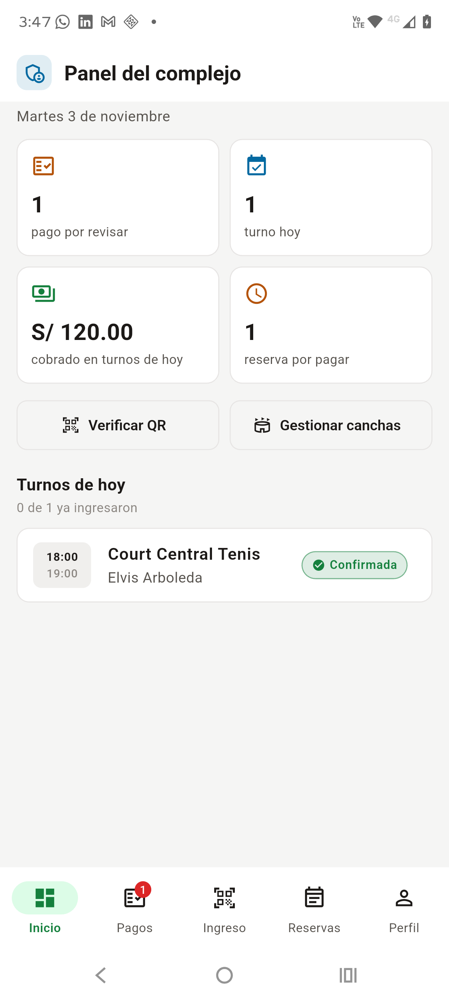 | 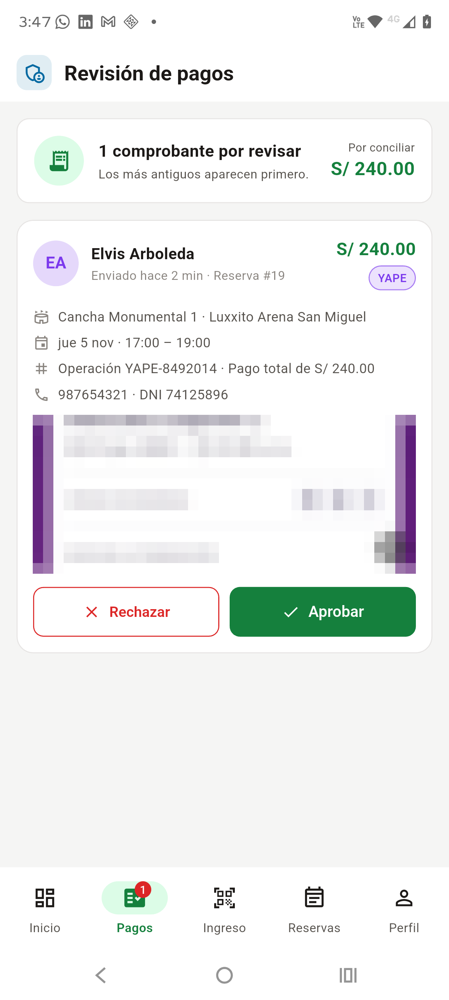 |
| **Ticket QR** | **Ingreso registrado** | **QR ya usado** | **Cancelación 24 h** |
| 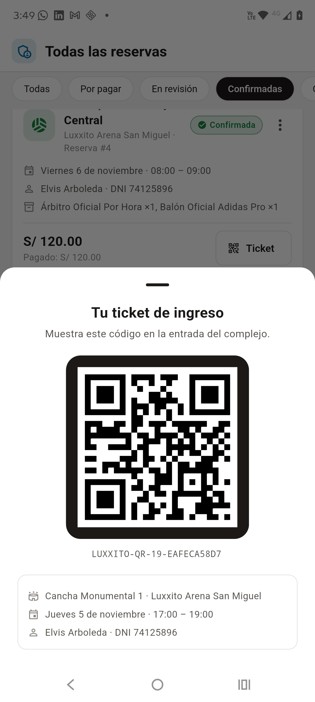 | 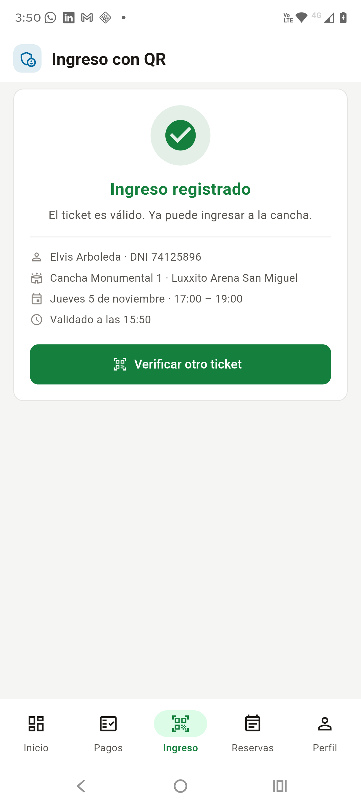 | 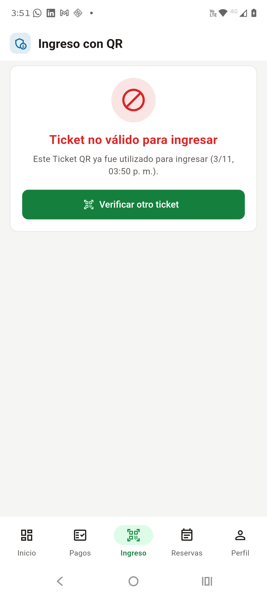 | 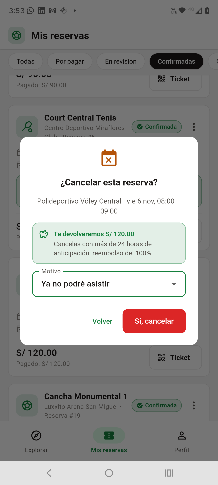 |

---

## 3. Consultas SQL de respaldo

Para mostrar la persistencia en el **SQL Editor** de Supabase (reemplazar `:id` por el número de la reserva):

```sql
-- Últimas reservas creadas desde la app
SELECT id, cliente_nombre, fecha, hora_inicio, hora_fin, total, monto_pagado,
       monto_devolucion, estado, codigo_qr, qr_usado_at, expires_at, updated_at
FROM reservas
ORDER BY id DESC
LIMIT 5;

-- Extras de la reserva de la demo
SELECT re.reserva_id, e.nombre, re.cantidad, re.precio_unitario, re.subtotal
FROM reserva_extras re
JOIN extras e ON e.id = re.extra_id
WHERE re.reserva_id = :id;

-- Historial de pagos de la reserva (envío, rechazo, aprobación)
SELECT id, metodo, modalidad, monto, numero_operacion, comprobante_url, estado, observacion, created_at, reviewed_at
FROM pagos
WHERE reserva_id = :id
ORDER BY id;
```

---

## 4. Si algo falla durante la demo

| Síntoma | Causa probable | Solución rápida |
|---|---|---|
| La app dice "Error de conexión con la API" | El backend no está levantado o falta `adb reverse` | `npm run dev` y `adb reverse tcp:3000 tcp:3000` |
| `/api/health` dice `LOCAL_STORE` | Falta `backend/.env` o tiene valores de ejemplo | Revisar `DATABASE_URL` y reiniciar el backend |
| "Ese horario ya no está libre" en el paso 3 | Ya existe una reserva activa en ese horario | Elegir otra fecha u horario (o cancelar la anterior) |
| "No se pueden registrar reservas en fechas u horas que ya han transcurrido" | Se eligió una hora pasada | Usar una fecha futura |
| No aparecen las pestañas Pagos e Ingreso | La sesión es de jugador | Cerrar sesión y entrar con la cuenta de administrador |
| La app tarda en responder al inicio | Render (plan gratuito) estaba dormido | Abrir `/api/health` 1 o 2 minutos antes de la demo |
| La cámara no abre en Ingreso | Falta el permiso de cámara | Aceptar el permiso, o escribir el código del ticket |
| Supabase no muestra la fila nueva | La vista del Table Editor no se refrescó | Botón *Refresh* o usar las consultas de la sección 3 |
